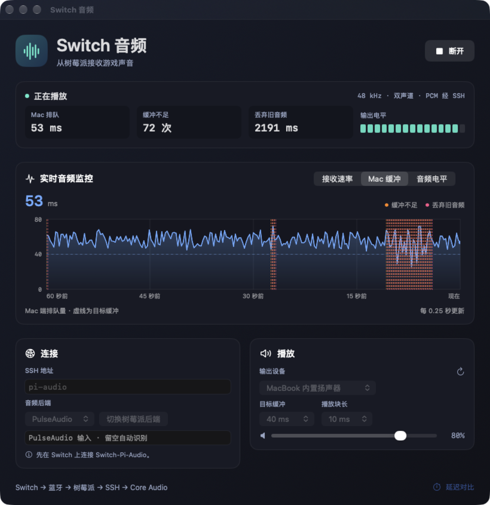

# Switch Pi Audio

[简体中文](README.zh-CN.md) · [OpenWrt setup](docs/openwrt.md) · [Latency measurements](docs/measurements.md)

Play Nintendo Switch game audio through your Mac speakers. The Raspberry Pi acts as a Bluetooth A2DP speaker and sends the audio to a native macOS player over SSH. The Pi uses its onboard Bluetooth, and the Mac and Pi can be on the same LAN.



*The native macOS app displaying a replay of measurements from an actual playback session.*

| Mode | Raspberry Pi | Audio sent over SSH |
| --- | --- | --- |
| **PulseAudio** (default) | BlueZ and PulseAudio receive and decode A2DP audio | 48 kHz, stereo, 16-bit PCM |
| **BlueZ direct** (experimental) | The Go receiver reads the BlueZ media transport and extracts SBC frames | SBC, decoded in the Mac app |

Both modes use the same Core Audio player. The monitor shows the last 60 seconds of SSH audio throughput, Mac queue depth, PCM level, buffer underruns, and evictions of old audio. Start at **80 ms** for playback stability, then try a smaller buffer if your setup can sustain it.

## Requirements

- Apple Silicon Mac with macOS 14 or later.
- A Raspberry Pi 4B with an ARM64 OpenWrt-family image and a working onboard Bluetooth controller. The tested image was ImmortalWrt 24.10.1 (`bcm27xx/bcm2711`).
- A Switch with Bluetooth audio output. The two backends were tested on Nintendo Switch 2.
- An SSH alias or `user@host` reachable from the Mac. This OpenWrt setup uses root and key-based SSH. It uses a local Unix socket and the existing SSH connection for the audio stream.

## Build and connect

1. Clone the repository and build the app with the Apple Command Line Tools (`xcode-select --install` if needed).

   ```sh
   git clone https://github.com/Little-King2022/switch-pi-audio.git
   cd switch-pi-audio
   ./macOS/build.sh
   open "macOS/build/Switch Pi Audio.app"
   ```

2. Build and install the Pi services using the [OpenWrt setup guide](docs/openwrt.md). Verify that an SSH command succeeds without an interactive prompt before connecting in the app.

   ```sh
   ssh -o BatchMode=yes pi-audio /usr/libexec/switch-audio-backend status
   ```

3. On the Switch, open **System Settings → Bluetooth Audio** and connect to **Switch-Pi-Audio**. Start a game with audio.
4. In the macOS app, enter the same SSH alias in **SSH address**, select the backend and output, and click **Connect**. Leave the PulseAudio source field blank for automatic selection when one Bluetooth input is connected.

### Choose the app language

The app follows the first supported language in your macOS preferred-language list: English or Simplified Chinese. If neither is listed, it uses English. Use **Language** in the footer to choose **English**, **简体中文**, or **System**. The choice applies immediately, without disconnecting audio, and is remembered for the next launch. The app bundle and window always use the English name `Switch Pi Audio`.

The build produces a locally ad-hoc-signed app, not a notarized installer. After rebuilding, launch the new `Switch Pi Audio.app`, not an older copy with a Chinese filename.

### Switch or restore a backend

Disconnect the app, select the backend under **Audio backend**, and click **Switch Pi backend**. Reconnect the Bluetooth device on the Switch, then connect in the app again. You can also switch from a terminal.

```sh
ssh pi-audio /usr/libexec/switch-audio-backend bluez
ssh pi-audio /usr/libexec/switch-audio-backend pulse
```

PulseAudio starts on reboot. The BlueZ experiment is enabled on demand. If BlueZ fails to register when switching, the selector attempts to restore PulseAudio.

### Troubleshooting

- **SSH fails:** Confirm the same alias works with `BatchMode=yes`; the app cannot answer a password or host-key prompt.
- **Connected, but silent:** Confirm the Switch is playing through `Switch-Pi-Audio` and the Mac has the desired output selected. If PulseAudio has more than one Bluetooth source, specify the full source name.
- **Buffer underruns:** Try 80 or 120 ms before reducing the target buffer. The Mac queue metric is not the end-to-end latency.

## Source and contributions

- [macOS](macOS/) contains the SwiftUI app, Core Audio player, monitoring curves, and SBC decoder.
- [pi](pi/) contains the Go discovery agent, SBC receiver, and OpenWrt `procd` service scripts.
- [benchmarks](benchmarks/) contains the optional Pi-side timing probes. Normal playback works with the tools in the setup guide. The optional acoustic comparison in the Mac app also requires FFmpeg and microphone permission.

Issues and pull requests are welcome. For a playback issue, include the Mac model, Pi firmware, backend, SSH network type, buffer settings, and any observed underruns. Share redacted logs and remove addresses and pairing keys.

## License

Apache-2.0. The bundled Android/Open Interface SBC decoder has its [own notices and source provenance](macOS/Decoder/SOURCE.md). [Full license text](LICENSE).

An independent community project.
