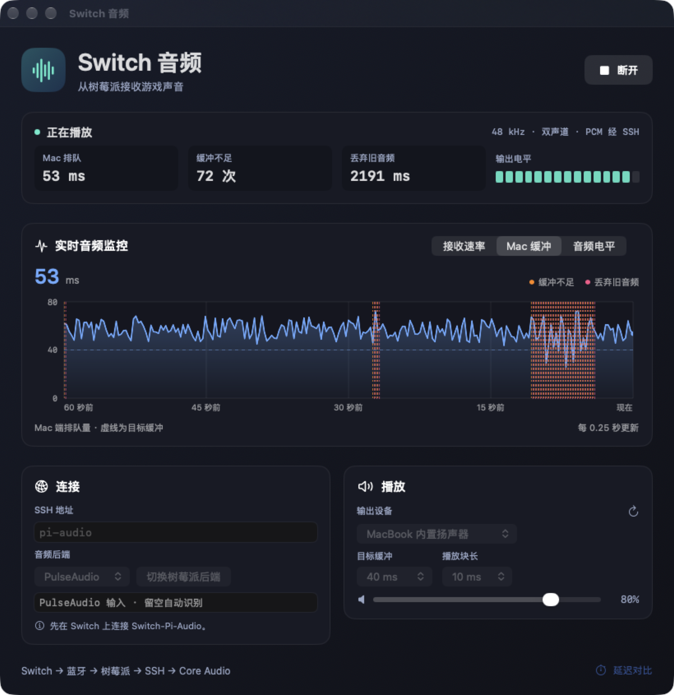

# Switch Pi Audio

[English](README.md) · [OpenWrt 安装步骤](docs/openwrt.zh-CN.md) · [延迟实测](docs/measurements.zh-CN.md)

把任天堂 Switch 的游戏声音送到 Mac 扬声器。树莓派用板载蓝牙充当 A2DP 音箱，再通过 SSH 把音频传给 macOS 原生播放器。Mac 和树莓派可以在同一个局域网内连接。



*截图使用原生 App 回放一段真实的播放监控数据。*

| 模式 | 树莓派 | SSH 传输内容 |
| --- | --- | --- |
| **PulseAudio**（默认） | 由 BlueZ 和 PulseAudio 接收并解码 A2DP 音频 | 48 kHz 双声道 16 位 PCM |
| **BlueZ 直读**（实验） | Go 接收器读取 BlueZ 媒体传输并提取 SBC 帧 | SBC，由 Mac App 解码 |

两种模式共用 Core Audio 播放器。监控区显示最近 60 秒的 SSH 音频接收速率、Mac 排队量、PCM 电平、缓冲不足和旧音频丢弃。建议从 **80 ms** 目标缓冲开始，稳定后再尝试调低。

## 系统要求

- Apple Silicon Mac，运行 macOS 14 或更新版本。
- 树莓派 4B，使用 ARM64 OpenWrt 系统且板载蓝牙可用。测试系统为 ImmortalWrt 24.10.1（`bcm27xx/bcm2711`）。
- 支持蓝牙音频输出的 Nintendo Switch。两种后端均在 Nintendo Switch 2 上测试过。
- Mac 可通过 SSH 别名或 `user@host` 访问树莓派。本指南使用 root 和 SSH 密钥登录；音频通过本地 Unix 套接字和现有 SSH 连接传输。

## 构建和连接

1. 安装 Apple 命令行工具（如有需要运行 `xcode-select --install`），克隆仓库并构建 App。

   ```sh
   git clone https://github.com/Little-King2022/switch-pi-audio.git
   cd switch-pi-audio
   ./macOS/build.sh
   open "macOS/build/Switch Pi Audio.app"
   ```

2. 按 [OpenWrt 安装步骤](docs/openwrt.zh-CN.md) 构建并安装树莓派服务。用自己的 SSH 别名替换示例中的 `pi-audio`，连接前确认命令无需交互即可执行：

   ```sh
   ssh -o BatchMode=yes pi-audio /usr/libexec/switch-audio-backend status
   ```

3. 在 Switch 打开「设置 → 蓝牙音频」，连接 **Switch-Pi-Audio**，然后启动有声音的游戏。
4. 在 App 填写同一个 **SSH 地址**，选择音频后端和输出设备，再点击 **连接**。只有一路蓝牙输入时，可将 PulseAudio 输入留空，由 App 自动识别。

### 切换界面语言

App 默认按 macOS 语言偏好列表选择第一个受支持的语言（英文或简体中文），都不支持时使用英文。在窗口底部的 **语言** 菜单选择 **English**、**简体中文** 或 **跟随系统**。切换即时生效，不会中断播放，下次启动也会保留选择。App 文件和窗口标题始终使用英文名 `Switch Pi Audio`。

构建产物使用本地临时签名，不是经过 Apple 公证的安装包。重新构建后请打开新的 `Switch Pi Audio.app`，不要误开旧的中文文件名版本。

### 切换或恢复后端

先断开 App 播放，在 **音频后端** 选择目标后端并点击 **切换树莓派后端**。然后在 Switch 上重新连接蓝牙，最后回到 App 点 **连接**。也可在终端操作：

```sh
ssh pi-audio /usr/libexec/switch-audio-backend bluez
ssh pi-audio /usr/libexec/switch-audio-backend pulse
```

树莓派重启后默认使用 PulseAudio。BlueZ 直读按需开启，如注册失败，切换脚本会尝试恢复 PulseAudio。

### 常见问题

- **SSH 连接失败：** 用同一个别名确认 `BatchMode=yes` 可以登录。App 无法输入密码，也无法交互确认主机密钥。
- **连接后没有声音：** 确认 Switch 正通过 `Switch-Pi-Audio` 播放，且 Mac 选择了正确的输出设备。若有多个蓝牙输入，请填写完整的 PulseAudio 输入名称。
- **频繁缓冲不足：** 先试 80 或 120 ms，再逐步调低目标缓冲。Mac 排队量不是端到端延迟。

## 源码和贡献

- [macOS](macOS/)：SwiftUI 界面、Core Audio 播放器、监控曲线和 SBC 解码器。
- [pi](pi/)：Go 发现代理、SBC 接收器和 OpenWrt `procd` 服务脚本。
- [benchmarks](benchmarks/)：可选的链路计时工具。正常播放只需要安装指南列出的工具；Mac App 中的声学延迟对比另需 FFmpeg 和麦克风权限。

欢迎提交 Issue 或 PR。反馈播放问题时，请提供 Mac 型号、树莓派固件、音频后端、SSH 网络类型、缓冲设置和出现的缓冲不足情况。分享日志前请移除地址和配对密钥。

## 许可证

本项目采用 [Apache-2.0](LICENSE)。内置 Android/Open Interface SBC 解码器另有[源码及许可说明](macOS/Decoder/SOURCE.md)。

本项目为独立社区项目。
