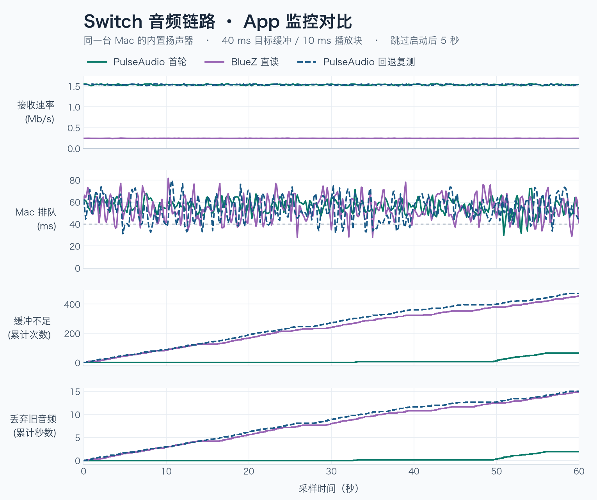

# Playback and latency measurements

[简体中文](measurements.zh-CN.md) · [Project home](../README.md)

This is a prototype result from a Switch 2, a Pi 4B on ImmortalWrt 24.10.1, and an Apple Silicon Mac using its internal speakers.



Each App trace covers 60 seconds after a 5-second warm-up. All three passes use a 40 ms target buffer and 10 ms blocks. “Mac queue” reports already buffered audio in the app and Audio Queue. It measures one component of latency. Underruns count entries into rebuffering, and evictions count the duration of old audio discarded by the bounded queue.

| Mode | Median SSH audio payload | Underruns | Evicted audio |
| --- | ---: | ---: | ---: |
| PulseAudio, first pass | 1.54 Mb/s | 64 | 1.90 s |
| BlueZ direct | 0.24 Mb/s | 456 | 14.94 s |
| PulseAudio, after rollback | 1.53 Mb/s | 474 | 15.03 s |

The 40 ms setting was sensitive to run-to-run variation. In a short follow-up at 80 ms, PulseAudio recorded zero underruns and zero evictions over 22 seconds of steady playback.

A separate 15-second test matched audio at Linux HCI reception to the corresponding output from the Pi's SSH audio producer on the same clock. The median was 1.15 ms for PulseAudio and 0.38 ms for BlueZ direct. SBC reduced the median time spent in that Pi-side segment by about 0.8 ms. End-to-end delay from the Switch to the Mac speakers was outside this measurement.

## Reproduce

`measure-mac.py` runs the Pi-side probe over SSH. It needs Python 3 and NumPy on the Mac, Python 3 and access to the Bluetooth monitor socket on the Pi, and FFmpeg on the Mac for the PulseAudio waveform match. Close the macOS receiver before testing BlueZ direct so the probe is the only subscriber. Audio samples are matched in memory and the output is timing aggregates.

```sh
python3 benchmarks/measure-mac.py pulse --host pi-audio
python3 benchmarks/measure-mac.py bluez --host pi-audio
```

Switch to the matching backend and reconnect the console before each run. The separate **Latency Comparison** feature in the Mac app uses local test tones and the microphone to compare two Mac playback methods.
