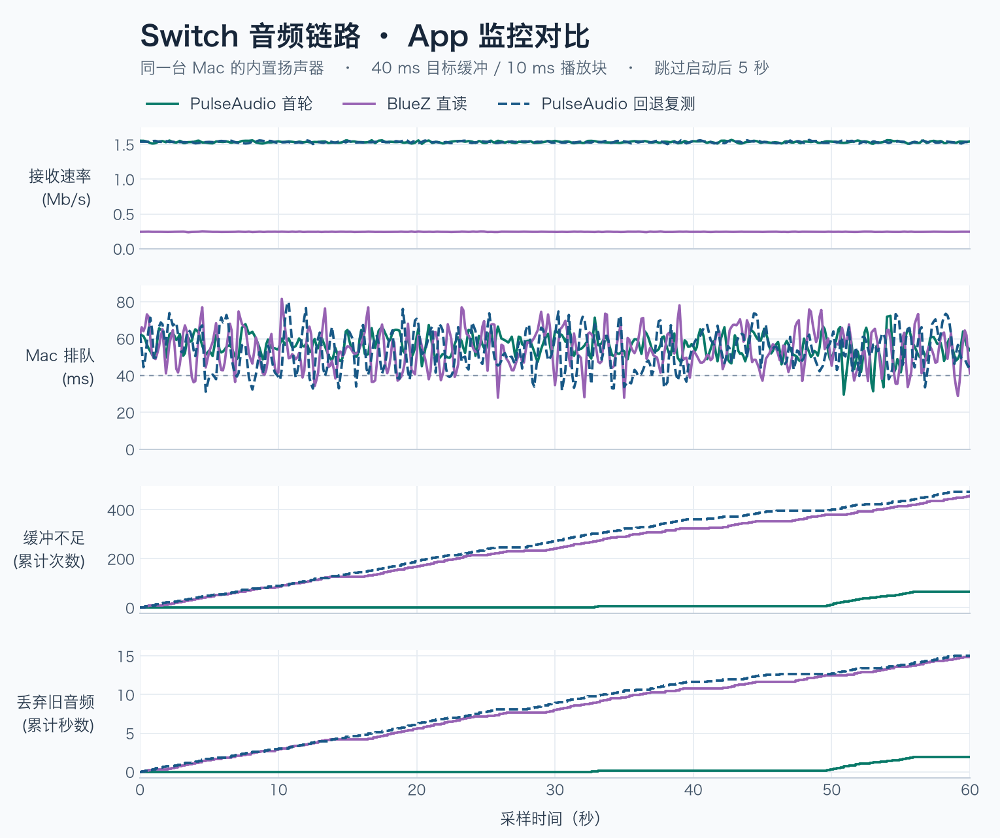

# 播放与延迟实测

[English](measurements.md) · [项目首页](../README.zh-CN.md)

原型测试使用 Switch 2、运行 ImmortalWrt 24.10.1 的树莓派 4B，以及使用内置扬声器的 Apple Silicon Mac。



每条 App 曲线在预热 5 秒后记录 60 秒。三轮均设置 40 ms 目标缓冲和 10 ms 音频块。“Mac 队列”统计 App 和 Audio Queue 中已缓冲的音频，只反映延迟的一部分。缓冲不足次数记录重新缓冲的触发次数，丢弃旧音频时长则统计有界队列淘汰的数据量，以音频时长计。

| 后端 | SSH 音频有效载荷速率中位数 | 缓冲不足次数 | 丢弃旧音频时长 |
| --- | ---: | ---: | ---: |
| PulseAudio（第一轮） | 1.54 Mb/s | 64 | 1.90 s |
| BlueZ 直读 | 0.24 Mb/s | 456 | 14.94 s |
| PulseAudio（切回后） | 1.53 Mb/s | 474 | 15.03 s |

40 ms 目标缓冲下，各轮结果波动较大。之后以 80 ms 为目标缓冲做了一次短测，PulseAudio 在 22 秒连续播放期间未发生缓冲不足，也没有丢弃旧音频。

另一次 15 秒测试在树莓派上使用同一时钟，将 Linux HCI 接收的音频与树莓派 SSH 音频输出端的对应音频匹配。该段延迟中位数为 PulseAudio 1.15 ms、BlueZ 直读 0.38 ms。直接传输 SBC 仅让**这段树莓派端的处理**缩短约 0.8 ms，未测量从 Switch 到 Mac 扬声器的端到端延迟。

## 复现方法

`measure-mac.py` 通过 SSH 运行树莓派端探针。Mac 需要 Python 3 和 NumPy；匹配 PulseAudio 波形时还需要 FFmpeg。树莓派需要 Python 3，并允许访问蓝牙监控套接字。测试 BlueZ 直读前请关闭 Mac 接收 App，确保探针是唯一订阅者。音频样本在内存中匹配，脚本输出耗时统计。

```sh
python3 benchmarks/measure-mac.py pulse --host pi-audio
python3 benchmarks/measure-mac.py bluez --host pi-audio
```

每轮开始前切换到对应后端，并在 Switch 上重新连接。Mac App 内的“延迟对比”则使用本地测试音和麦克风比较两种 Mac 播放方式，是另一项测试。
